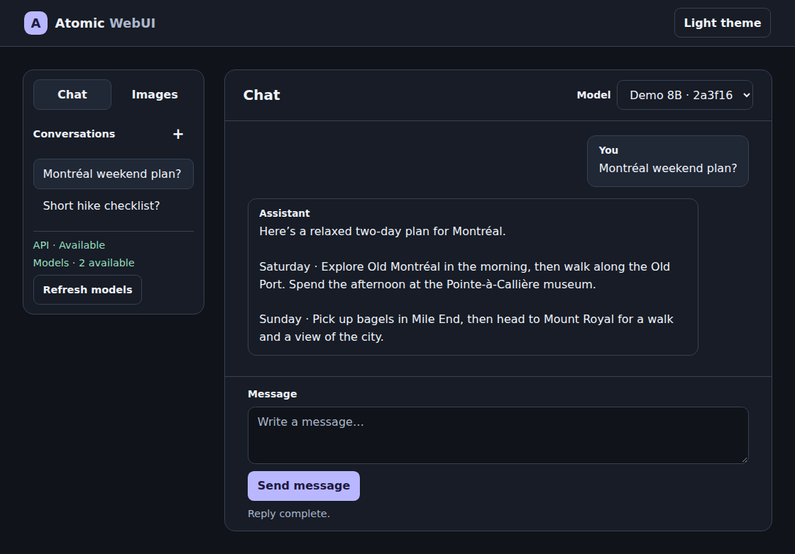
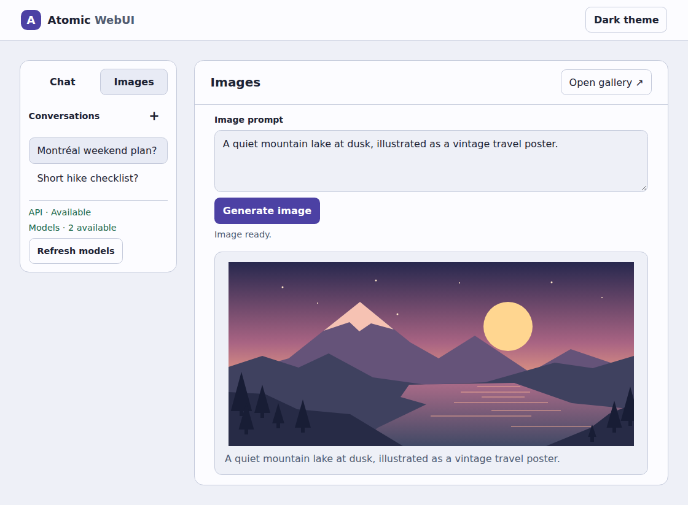

# Atomic Server WebUI

A lightweight browser interface for an existing Atomic Server public API. It provides streaming text chat, model selection, browser-local conversation history, light and dark themes, and an optional image generator and gallery link. The WebUI uses Python 3.10+ and the standard library.

## Screenshots

Captured with a local mock API and sample content.

### Chat in dark mode



### Images in light mode



## One-shot install

Run this as the user who will run the WebUI.

```sh
curl -fsSLo atc-webui-install.sh https://raw.githubusercontent.com/VA3KWJ/ATC-WebUI/main/install.sh && sh atc-webui-install.sh
```

The command requires curl, `sh`, and working HTTPS trust. It saves the installer in the current directory and runs it after the download succeeds. The installer reads `/etc/os-release` (or `/usr/lib/os-release`) and checks for Python 3.10+ with SSL, curl, and CA certificates. Where needed it installs prerequisites through APT, DNF, pacman, APK, or Zypper using root, `sudo`, or `doas`. Use a release with Python 3.10+ available.

The script supports Debian and Ubuntu, Fedora, RHEL and compatible distributions, Arch, Alpine, openSUSE, and derivatives identified through `ID_LIKE`. It installs these files for the current user.

| Path with default XDG directories | Purpose |
| --- | --- |
| `~/.local/share/atc-webui/` | Application files and the `run` launcher |
| `~/.config/atc-webui/config.sh` | Per-user settings |
| `~/.config/atc-webui/api-token` | Empty token file on first install, owned by the current user with mode `0600` |

The installer honors absolute `XDG_DATA_HOME` and `XDG_CONFIG_HOME` values and prints the resulting paths. Use directories controlled by the installer account or root. Rerunning it updates the application and launcher and preserves the contents of the settings and token files. It leaves startup to the operator after configuration.

To pin both the script and the application archive to a published commit, set `ref` to the full commit SHA.

```sh
ref='<full-commit-sha>'
curl -fsSLo atc-webui-install.sh "https://raw.githubusercontent.com/VA3KWJ/ATC-WebUI/$ref/install.sh" && ATC_WEBUI_REF="$ref" sh atc-webui-install.sh
```

## Configure and run

1. Run `atc api status` on the Atomic Server host to find its public API origin. Edit `~/.config/atc-webui/config.sh` and set `ATC_API_URL` to that origin, for example `http://127.0.0.1:1339`. Use HTTPS for a network upstream.
2. Put an Atomic **public API client token** in `~/.config/atc-webui/api-token`. Keep only the token on one line and keep the file owned by the account running the WebUI with mode `0600`. If `ATC_API_TOKEN` is already exported in the shell, unset it when using the token file.
3. Start the WebUI and open [http://127.0.0.1:8080](http://127.0.0.1:8080).

   ```sh
   ~/.local/share/atc-webui/run
   ```

The launcher runs in the foreground. Press Ctrl+C to stop it. To rotate the token, replace the configured token file with the new token, retain ownership and mode `0600`, and restart the WebUI. The empty installation placeholder must be populated before startup.

If the API is reachable and no chat models are listed, make a suitable chat model available through Atomic Server and select **Refresh chat models**. In the **Images** view, generation uses the image model currently loaded in Atomic Server by default. The view shows elapsed time while waiting for the public API and offers a **Stop** button. If the model is unavailable, load it in Atomic Server and submit again. Conversations and theme choices are stored in the current browser. A generated image preview lasts for the current page session.

Select **Stop** to end a streaming reply. Text already received stays in the conversation, including when the upstream stream is interrupted. Multiple tabs can save turns independently. Reload a tab to see turns saved in another tab. Existing browser history loads automatically.

## Manual installation from a checkout

Install Python 3.10+ and CA certificates using your distribution's package manager. Run these commands from the repository root to set up the token file for the first time.

```sh
config_dir="${XDG_CONFIG_HOME:-$HOME/.config}/atc-webui"
(umask 077; mkdir -p "$config_dir"; set -C; : > "$config_dir/api-token")
```

Populate the file with your token, then start the application with the public API origin for your installation.

```sh
unset ATC_API_TOKEN
ATC_API_URL='http://127.0.0.1:1339' \
ATC_API_TOKEN_FILE="$config_dir/api-token" \
python3 server.py
```

## Environment variables

| Variable | Default | Purpose |
| --- | --- | --- |
| `ATC_API_URL` | Required | Atomic public API origin without a route or query. HTTPS is required for network upstreams. |
| `ATC_API_TOKEN_FILE` | Recommended | Path to the token file, owned and readable by the WebUI user with no group or other permissions. |
| `ATC_API_TOKEN` | Optional alternative | Supply the bearer token through the service environment. Set exactly one token source. |
| `ATC_WEBUI_HOST` | `127.0.0.1` | WebUI bind address. |
| `ATC_WEBUI_PORT` | `8080` | WebUI listen port. |
| `ATC_WEBUI_PUBLIC_ORIGIN` | Unset | Browser-facing origin such as `https://webui.example.org`, without a trailing slash. Required for a wildcard bind. Set this when using a reverse proxy. |
| `ATC_WEBUI_IMAGE_MODEL` | Unset | Use the currently loaded Atomic image model when unset. Set an identifier to request a specific model, or set an empty value to disable image generation. |
| `ATC_WEBUI_CONTROL_DATA_DIR` | Unset | Absolute Atomic Server data directory on the same machine. Enables live image progress when `ATC_WEBUI_IMAGE_MODEL` is unset. |
| `ATC_WEBUI_GALLERY_URL` | Unset | Optional gallery link presented in the Images view. |
| `ATC_WEBUI_REF` | `main` | Installer-only Git branch, tag, or commit to download. |

### Live image progress

To show sampling steps and Atomic’s time estimate, run the WebUI as the same OS user as Atomic Server and add this setting to the WebUI configuration. Use your actual Atomic data directory if you moved it.

```sh
ATC_WEBUI_CONTROL_DATA_DIR="${XDG_DATA_HOME:-$HOME/.local/share}/atomic-chat-cli/data"
```

Restart the WebUI after updating its settings. The backend uses that directory to find the loopback control listener and its owner-only token. Use a data directory controlled by the Atomic Server account. The backend reads the requested job’s progress and a preview of its completed gallery image. Keep the Atomic control listener bound to loopback. Explicit image model overrides and clients requesting the binary response use the public API. If you use a reverse proxy, disable response buffering for image progress as well as chat.

## Network access

For remote access, keep the WebUI bound to loopback behind an HTTPS reverse proxy. Require separate access authentication at the proxy. The Atomic API token authenticates only the WebUI's upstream requests.

Set `ATC_WEBUI_PUBLIC_ORIGIN` to the external HTTPS origin and preserve the incoming host. Disable proxy buffering for streamed replies. Chat and discovery use 15-second upstream I/O waits and a 180-second client connection deadline. Image generation allows up to 10 minutes for the upstream job and additional time for connection setup and response delivery. Set the reverse proxy's read timeout accordingly, since Atomic returns the image only after generation finishes. The WebUI accepts up to 16 concurrent connections with at most two image requests. Additional image requests return HTTP 503 while both image slots are occupied. This example belongs inside an existing Nginx HTTPS server configuration.

```nginx
location / {
    auth_basic "Atomic WebUI";
    auth_basic_user_file /etc/nginx/atc-webui.htpasswd;

    proxy_pass http://127.0.0.1:8080;
    proxy_set_header Host $http_host;
    proxy_http_version 1.1;
    proxy_buffering off;
    proxy_read_timeout 640s;
}
```

For direct access on a trusted LAN, add both settings to `~/.config/atc-webui/config.sh` and restart the launcher. Replace `192.168.1.10` with the WebUI machine's LAN address and use the configured listen port in the URL.

```sh
ATC_WEBUI_HOST="0.0.0.0"
ATC_WEBUI_PUBLIC_ORIGIN="http://192.168.1.10:8080"
```

Open the URL configured in `ATC_WEBUI_PUBLIC_ORIGIN`. The WebUI checks requests against that origin. Restrict direct access to trusted clients, since they can use the WebUI to make requests with its upstream API token.

## Validation

The server tests use Python 3.10+ and a local mock API. The browser history tests use Node.js 22 and a simulated browser environment.

```sh
python3 -m unittest discover -s tests -v
node --test tests/test_history.js
```

See the [API compatibility notes](docs/api-compatibility.md) for mock and live test results.
