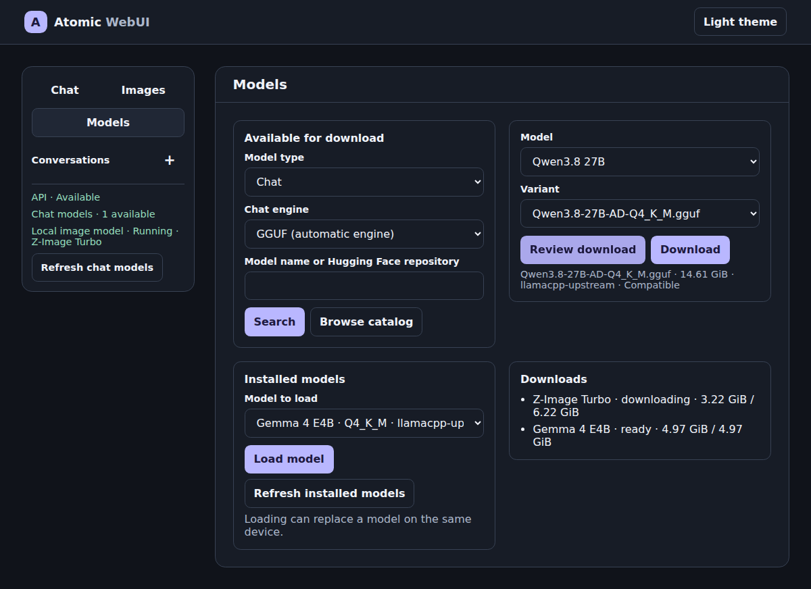

# Atomic Server WebUI

A lightweight browser interface for Atomic Server. It provides streaming text chat, browser-local conversation history, light and dark themes, optional image generation and a gallery for locally saved images, and opt-in model management. The WebUI uses Python 3.10+ and the standard library.

## Screenshots

Captured with a local mock API and sample content.

### Chat in dark mode


### Models in dark mode



### Images and gallery in light mode


## One-shot install

Run this as the user who will run the WebUI.

```sh
curl -fsSLo atc-webui-install.sh https://raw.githubusercontent.com/VA3KWJ/ATC-WebUI/main/install.sh && sh atc-webui-install.sh
```

The command requires curl, `sh`, and working HTTPS trust. It saves the installer in the current directory and runs it after the download succeeds. The installer reads `/etc/os-release` (or `/usr/lib/os-release`) and checks for Python 3.10+ with SSL, curl, and CA certificates. Where needed it installs prerequisites through APT, DNF, pacman, APK, or Zypper using root, `sudo`, or `doas`. Use a release with Python 3.10+ available.

The script supports Debian and Ubuntu, Fedora, RHEL and compatible distributions, Arch, Alpine, openSUSE, and derivatives identified through `ID_LIKE`. It installs these files for the current user.

| Path with default XDG directories | Purpose |
| --- | --- |
| `~/.local/share/atc-webui/` | Application files and the `run` launcher |
| `~/.config/atc-webui/config.sh` | Per-user settings |
| `~/.config/atc-webui/api-token` | Empty token file on first install, owned by the current user with mode `0600` |

The installer honors absolute `XDG_DATA_HOME` and `XDG_CONFIG_HOME` values and prints the resulting paths. Use directories controlled by the installer account or root. Rerunning it updates the application and launcher and preserves the contents of the settings and token files.

On systemd, OpenRC, and Debian-style SysVinit systems, the installer registers a boot service named `atc-webui`. Run the installer as the account that should run the WebUI. Registration uses root, `sudo`, or `doas`. Enable and start the service after configuring it. A reinstall preserves boot enablement and leaves a running service in place until you restart it. Hosts without an active supported init system can use the foreground launcher.

To pin both the script and the application archive to a published commit, set `ref` to the full commit SHA.

```sh
ref='<full-commit-sha>'
curl -fsSLo atc-webui-install.sh "https://raw.githubusercontent.com/VA3KWJ/ATC-WebUI/$ref/install.sh" && ATC_WEBUI_REF="$ref" sh atc-webui-install.sh
```

## Configure and run

1. Run `atc api status` on the Atomic Server host to find its public API origin. Edit `~/.config/atc-webui/config.sh` and set `ATC_API_URL` to that origin, for example `http://127.0.0.1:1339`. Use HTTPS for a network upstream.
2. Put an Atomic **public API client token** in `~/.config/atc-webui/api-token`. Keep only the token on one line and keep the file owned by the account running the WebUI with mode `0600`. If `ATC_API_TOKEN` is already exported in the shell, unset it when using the token file.
3. Enable and start the WebUI using the commands for your init system, then open [http://127.0.0.1:8080](http://127.0.0.1:8080).

Run these service commands as root or prefix them with `sudo` or `doas` as appropriate.

| Init system | Enable and start | Check status | Restart |
| --- | --- | --- | --- |
| systemd | `systemctl enable --now atc-webui` | `systemctl status atc-webui` | `systemctl restart atc-webui` |
| OpenRC (Alpine) | `rc-update add atc-webui default`, then `rc-service atc-webui start` | `rc-service atc-webui status` | `rc-service atc-webui restart` |
| SysVinit (Debian-style) | `update-rc.d atc-webui defaults`, then `update-rc.d atc-webui enable` and `service atc-webui start` | `service atc-webui status` | `service atc-webui restart` |

For a foreground run, use the launcher path printed by the installer, typically `~/.local/share/atc-webui/run`. Press Ctrl+C to stop it. To rotate the token, replace the configured token file with the new token, retain ownership and mode `0600`, and restart the WebUI. The empty installation placeholder must be populated before startup.

If the API is reachable and no chat models are listed, make a suitable chat model available through Atomic Server and select **Refresh chat models**. In the **Images** view, generation uses the image model currently loaded in Atomic Server by default. The view shows elapsed time while waiting for the public API and offers a **Stop** button. If the model is unavailable, load it in Atomic Server and submit again. A generated image preview lasts for the current page session. Click the preview to open the original image in a new tab or choose **Download image** to save it. Conversations and theme choices are stored in the current browser.

Select **Stop** to end a streaming reply. Text already received stays in the conversation, including when the upstream stream is interrupted. Multiple tabs can save turns independently. Reload a tab to see turns saved in another tab. Existing browser history loads automatically.

## Manual installation from a checkout

Install Python 3.10+ and CA certificates using your distribution's package manager. Run these commands from the repository root to set up the token file for the first time.

```sh
config_dir="${XDG_CONFIG_HOME:-$HOME/.config}/atc-webui"
(umask 077; mkdir -p "$config_dir"; set -C; : > "$config_dir/api-token")
```

Populate the file with your token, then start the application with the public API origin for your installation.

```sh
unset ATC_API_TOKEN
ATC_API_URL='http://127.0.0.1:1339' \
ATC_API_TOKEN_FILE="$config_dir/api-token" \
python3 server.py
```

## Environment variables

| Variable | Default | Purpose |
| --- | --- | --- |
| `ATC_API_URL` | Required | Atomic public API origin without a route or query. HTTPS is required for network upstreams. |
| `ATC_API_TOKEN_FILE` | Recommended | Path to the token file, owned and readable by the WebUI user with no group or other permissions. |
| `ATC_API_TOKEN` | Optional alternative | Supply the bearer token through the service environment. Set exactly one token source. |
| `ATC_WEBUI_HOST` | `127.0.0.1` | WebUI bind address. |
| `ATC_WEBUI_PORT` | `8080` | WebUI listen port. |
| `ATC_WEBUI_PUBLIC_ORIGIN` | Unset | Browser-facing origin such as `https://webui.example.org`, without a trailing slash. Required for a wildcard bind. Set this when using a reverse proxy. |
| `ATC_WEBUI_IMAGE_MODEL` | Unset | Use the currently loaded Atomic image model when unset. Set an identifier to request a specific model, or set an empty value to disable image generation. |
| `ATC_WEBUI_CONTROL_DATA_DIR` | Unset | Absolute path to the local Atomic Server data directory. Enables the sidebar's local image model status and, with automatic model selection, live generation progress. |
| `ATC_WEBUI_MODEL_CONTROL` | Disabled | Set to `1` to enable the Models tab on loopback or a directly connected private LAN. |
| `ATC_WEBUI_ATC_BIN` | `atc` on PATH | Optional absolute path to the Atomic Server CLI. |
| `ATC_WEBUI_ATC_DATA_FOLDER` | Atomic CLI default | Optional absolute path to the data folder of the Atomic instance serving `ATC_API_URL`. |
| `ATC_WEBUI_GALLERY_URL` | Unset | Optional gallery link presented in the Images view. |
| `ATC_WEBUI_GALLERY_DIR` | Unset | Absolute path to the local Atomic image directory. Enables the gallery in the Images view. |
| `ATC_WEBUI_REF` | `main` | Installer-only Git branch, tag, or commit to download. |

### Local image model status and progress

Run the WebUI on the same machine and as the same OS user as Atomic Server. For an installer-managed service or foreground launcher, add this line to `~/.config/atc-webui/config.sh`, or use the corresponding file under `$XDG_CONFIG_HOME`. For a manual launch from a checkout, set the variable in the environment that starts `server.py`.

```sh
ATC_WEBUI_CONTROL_DATA_DIR="${XDG_DATA_HOME:-$HOME/.local/share}/atomic-chat-cli/data"
```

If Atomic Server uses a custom data directory, use that absolute path. It should contain `atc/run/daemon.json` and `atomic-core/control-token`. The WebUI reads these files to connect to Atomic's loopback control listener. Keep the token readable only by the Atomic Server account and keep the listener bound to loopback.

Restart the WebUI after saving the setting. The **Local image model** row refreshes every 10 seconds while the tab is visible. It shows **Running** and the model name when an image model is loaded. If it shows **Status unavailable** while the public API is available, check that the running WebUI received the setting and can read the two files under the configured directory. Public API image generation can still work when local model status is unavailable.

Leave `ATC_WEBUI_IMAGE_MODEL` unset to use the loaded local model and see live sampling steps and Atomic's estimated time remaining. An explicit image model override uses the public API and shows elapsed time during generation. If you use a reverse proxy, disable response buffering for image progress as well as chat.

### Local image gallery

To show Atomic's saved images in the **Images** view, add this setting to the WebUI configuration and restart the WebUI. Use the actual path if you moved Atomic's data directory.

```sh
ATC_WEBUI_GALLERY_DIR="${XDG_DATA_HOME:-$HOME/.local/share}/atomic-chat-cli/data/images"
```

Use a directory controlled by the Atomic Server account and readable by the WebUI. Everyone with access to the WebUI can view the configured image library. The grid shows the newest saved images first. Use **Refresh** to pick up images saved elsewhere and select a thumbnail to open the full-size image. The gallery also refreshes after successful generation and displays the result once Atomic has saved it in the configured directory.

Hover over a gallery image or focus it with the keyboard to reveal **Save** and **Delete**. Both actions are always visible on touch devices. **Save** downloads a full-size PNG. **Delete** permanently removes the image and its thumbnail after confirmation. If the WebUI can write to the image directory, anyone with WebUI access can delete images.

## Manage local models

> [!WARNING]
> **Model controls currently have no WebUI authentication.** Anyone who can reach an enabled instance on the LAN can start multi-gigabyte downloads, load or unload models and interrupt inference, or permanently delete completed model downloads. The Atomic API token authenticates WebUI requests to Atomic Server. **Enable model controls only on a trusted private network and keep the WebUI off the public internet.** WebUI authentication is planned for a later release.

Run WebUI and Atomic Server under the same account. Use Atomic Server 0.2.21, keep `ATC_API_URL` on loopback, and set `ATC_WEBUI_MODEL_CONTROL=1` in the launcher configuration or environment. For LAN access, configure the WebUI host and public origin as shown below. Model controls accept direct connections from private IPv4 and unique-local IPv6 addresses when the WebUI is bound for network access.

The installer runs `command -v atc` and saves the absolute path as `ATC_WEBUI_ATC_BIN` in `config.sh` if a path was found and the setting is missing. Rerunning the installer preserves an existing selection. Without a configured path, the launcher checks its runtime `PATH`, `~/.local/bin/atc`, and `/usr/local/bin/atc`. Restart the WebUI after changing the setting.

Use the loopback URL for `ATC_API_URL` even if Atomic reports a wildcard bind. For example, a listener at `0.0.0.0:1339` is reachable by the WebUI at `http://127.0.0.1:1339`.

In **Models**, browse the Atomic catalog or search by name or Hugging Face repository ID. Chat search offers GGUF and the MLX or managed safetensors engines reported for the host. Image search covers Atomic catalog variants. Choose a variant, review its size and compatibility, then select **Download**. Atomic owns the job, and the **Downloads** list can show its progress after a page reload. Retrying the same confirmation after a request error reuses its request ID. Use Atomic Server's native controls to resume a job that reports a failed or interrupted state.

After downloading, choose a model under **Installed models** and select **Load model**. Loading may replace a model on the same device. Chat refreshes its available models after a successful load. Images uses the active Atomic image model unless `ATC_WEBUI_IMAGE_MODEL` specifies a model.

**Loaded models** shows the chat and image models currently running in Atomic, including models loaded from the CLI. Select **Unload** to free memory. To permanently remove a completed download, unload the model first, choose it under **Installed models**, and confirm **Delete model**. Atomic handles file removal. Gallery images stay in the gallery. Avoid switching models in another Atomic client while unloading or deleting in the WebUI.

Model selectors use the full width of their sections. The Models view uses two columns on wider screens and stacks the sections on narrower screens.

## Network access

For remote access to Chat and Images, keep the WebUI bound to loopback behind an HTTPS reverse proxy and require separate access authentication at the proxy. Leave model controls disabled on that instance.

Set `ATC_WEBUI_PUBLIC_ORIGIN` to the external HTTPS origin and preserve the incoming host. Disable proxy buffering for streamed replies. Chat and discovery use 15-second upstream I/O waits and a 180-second client connection deadline. Image generation allows up to 10 minutes for the upstream job and additional time for connection setup and response delivery. Set the reverse proxy's read timeout accordingly, since Atomic returns the image only after generation finishes. The WebUI accepts up to 16 concurrent connections with at most two image requests. Additional image requests return HTTP 503 while both image slots are occupied. This example belongs inside an existing Nginx HTTPS server configuration.

```nginx
location / {
    auth_basic "Atomic WebUI";
    auth_basic_user_file /etc/nginx/atc-webui.htpasswd;

    proxy_pass http://127.0.0.1:8080;
    proxy_set_header Host $http_host;
    proxy_http_version 1.1;
    proxy_buffering off;
    proxy_read_timeout 640s;
}
```

For direct access on a trusted LAN, add both settings to `~/.config/atc-webui/config.sh` and restart the WebUI. Replace `192.168.1.10` with the WebUI machine's LAN address and use the configured listen port in the URL.

```sh
ATC_WEBUI_HOST="0.0.0.0"
ATC_WEBUI_PUBLIC_ORIGIN="http://192.168.1.10:8080"
```

Open the URL configured in `ATC_WEBUI_PUBLIC_ORIGIN`. The WebUI checks requests against that origin. Restrict direct access to trusted clients, since they can use the WebUI to make requests with its upstream API token.

## Validation

The server tests use Python 3.10+ and a local mock API. The browser history tests use Node.js 22 and a simulated browser environment.

```sh
python3 -m unittest discover -s tests -v
node --test tests/test_history.js
```

See the [API compatibility notes](docs/api-compatibility.md) for mock and live test results.
